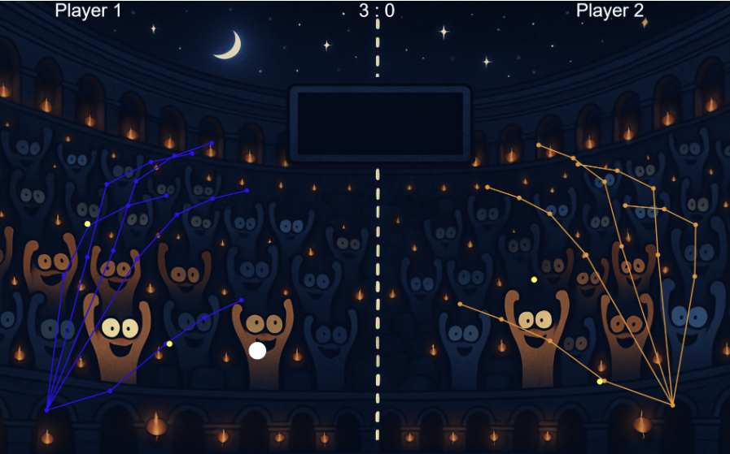

🏛️ Hand Pong
A webcam-controlled Pong game set in a coliseum. Your hands are the paddles, tracked in real time by machine learning running entirely in your browser. First to 10 points wins

**Requirements:** 
A webcam, an internet connection, a modern browser, and Python 3 (or Node.js).

**Instructions:**
- Clone the repo and open a terminal in its folder.
- Start a local server (opening main.html directly won't work, because browsers block the webcam on file://):
- Go to http://localhost:8000/main.html and allow camera access. 4. Click the canvas once to start the music. Press Esc to restart after game over.

**Credits**
p5.js for graphics and audio
TensorFlow.js and MediaPipe Hands for hand tracking
Built by Shiven Kothari
